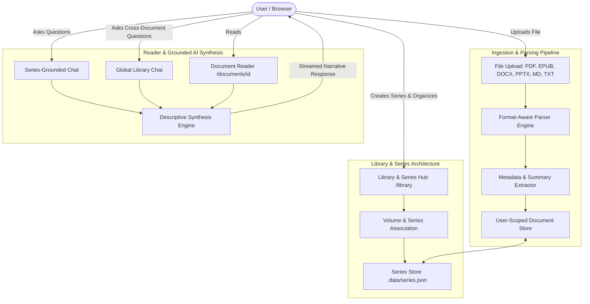

# Contexta 📚✨
### Enterprise Document Intelligence, Multi-Volume Series Management & Grounded AI Synthesis

**Contexta** is a full-stack document intelligence and knowledge management platform designed for ingesting, organizing, reading, and querying complex documents, research papers, light novels, and multi-volume book series.

Built with **Next.js 16 (App Router & Turbopack)**, **Clerk Authentication**, and the **Vercel AI SDK**, Contexta pairs an immersive dark-mode reader with volume-ordered series folders, single-account data isolation, and grounded, descriptive AI question-answering.

---

## 📑 Table of Contents
1. [Project Overview & Core Vision](#-project-overview--core-vision)
2. [End-to-End Engineering & Development Process](#-end-to-end-engineering--development-process)
   - [Phase 1: Multi-Format Document Ingestion & Parsing](#phase-1-multi-format-document-ingestion--parsing)
   - [Phase 2: Immersive Reader & Study Interface](#phase-2-immersive-reader--study-interface)
   - [Phase 3: Grounded AI Question Answering & Synthesis](#phase-3-grounded-ai-question-answering--synthesis)
   - [Phase 4: Conversation History & Safe Deletion Controls](#phase-4-conversation-history--safe-deletion-controls)
   - [Phase 5: Single-Account Isolation & Authentication](#phase-5-single-account-isolation--authentication)
   - [Phase 6: Stability & Performance Engineering](#phase-6-stability--performance-engineering)
   - [Phase 7: Library, Series & Multi-Book Folders](#phase-7-library-series--multi-book-folders)
3. [System Architecture & Data Flow](#-system-architecture--data-flow)
4. [File Structure & Directory Layout](#-file-structure--directory-layout)
5. [API Endpoints Reference](#-api-endpoints-reference)
6. [Getting Started & Local Setup](#-getting-started--local-setup)
7. [Tech Stack](#-tech-stack)

---

## 🔭 Project Overview & Core Vision

Traditional document Q&A tools suffer from three fundamental limitations:
1. **Shallow Chunk Extraction**: Most systems simply quote short snippets of raw text without synthesizing an intuitive, narrative explanation.
2. **Lack of Structure & Hierarchy**: Documents exist in a flat, unorganized list rather than structured collections (such as volumes of a light novel, chapters of a textbook, or phases of a research project).
3. **Format Fragility**: Users are typically restricted to PDFs, unable to comfortably upload EPUB eBooks, Word documents, or PowerPoint slide decks.

**Contexta** was engineered to solve these challenges by creating a unified knowledge workspace where documents can be ingested in any format, structured into series and folders with explicit volume ordering, read through a focus-oriented interface, and queried using grounded AI that delivers explanatory, synthesized insights.

---

## 🛠️ End-to-End Engineering & Development Process

The project followed a multi-phase engineering roadmap:

### Phase 1: Multi-Format Document Ingestion & Parsing
Contexta features a universal document processing pipeline ([lib/document-parser.ts](file:///c:/Users/sapha/OneDrive/Desktop/Projects/discord%20bots%20test/Contexta/lib/document-parser.ts)) capable of handling heterogeneous file types:
- **PDF Documents (`.pdf`)**: Extracted via format-aware normalization while preserving structural headers and producing data URLs for embedded viewer fallback.
- **EPUB eBooks (`.epub`)**: Unpacks EPUB archive packages, parses `container.xml` and OPF manifests, and extracts clean, readable text across all serialized chapters.
- **Word Documents (`.docx`, `.doc`)**: Converts raw OpenXML packages using `mammoth` into clean Markdown, preserving tables, headers, and bullet structures.
- **PowerPoint Decks (`.pptx`, `.ppt`)**: Extracts XML slide relationships and text shapes, transforming presentations into slide-by-slide Markdown sections (`## Slide 1`, `## Slide 2`).
- **Markdown & Text (`.md`, `.txt`)**: Native ingestion with frontmatter stripping.
- **Structured Data (`.csv`, `.json`)**: Tabular formatting and schema detection.

**Automated Metadata Enrichment**:
During upload, each document is analyzed to compute:
- Word count and estimated reading time (based on 200 wpm standard).
- Automatic 3-sentence executive summary.
- Key takeaway bullet points extracted from structural markers.

---

### Phase 2: Immersive Reader & Study Interface
The reader ([app/(root)/documents/[documentId]/page.tsx](file:///c:/Users/sapha/OneDrive/Desktop/Projects/discord%20bots%20test/Contexta/app/(root)/documents/[documentId]/page.tsx)) provides an uninterrupted reading experience:
- **Customizable Typography**: Real-time switching between Sans-serif, Serif, and Monospace typefaces, with font size adjustment (`sm`, `base`, `lg`, `xl`).
- **Focus / Zen Mode**: Expands the reading viewport and dims chrome for distraction-free reading.
- **In-Document Search**: Interactive keyword search that scrolls directly to matching sections.
- **Reading Progress Bar**: Dynamic scroll progress bar tracking position in long manuscripts.
- **Tabbed Views**: Switch between parsed Reader Mode, embedded PDF viewer, and Document Metadata.

---

### Phase 3: Grounded AI Question Answering & Synthesis
Contexta avoids shallow text quoting by implementing a narrative synthesis engine ([lib/llm-service.ts](file:///c:/Users/sapha/OneDrive/Desktop/Projects/discord%20bots%20test/Contexta/lib/llm-service.ts)):
- **Descriptive Explanations**: When asked questions like *"Who is the protagonist?"* or *"Explain the methodology"*, Contexta synthesizes an overarching narrative explaining the background, context, and implications rather than outputting isolated sentences.
- **Multi-Scope Context Retrieval**:
  1. **Single-Document Chat**: Queries grounded strictly in the currently viewed book or document.
  2. **Series-Grounded Chat**: Queries grounded across all volumes and documents within a specific series/folder.
  3. **Global Library Chat**: Cross-document query synthesis across the user's entire library.
- **Streaming UI**: Implemented via Vercel AI SDK (`createDataStreamResponse` and `useChat`) for low-latency streaming responses with markdown formatting (headers, blockquotes, bullet points).

---

### Phase 4: Conversation History & Safe Deletion Controls
- **User-Scoped Local Storage**: Chat messages are persisted client-side per document (`contexta_chat_<documentId>`), per series (`contexta_chat_series_<seriesId>`), and globally (`contexta_global_chat`).
- **Granular Deletion**:
  - Full conversation deletion with confirmation modals ([components/DeleteChatModal.tsx](file:///c:/Users/sapha/OneDrive/Desktop/Projects/discord%20bots%20test/Contexta/components/DeleteChatModal.tsx)).
  - Individual message removal directly from the chat stream.
- **Document Deletion**: Confirmatory deletion modals ([components/DeleteDocumentModal.tsx](file:///c:/Users/sapha/OneDrive/Desktop/Projects/discord%20bots%20test/Contexta/components/DeleteDocumentModal.tsx)) with clean cache invalidation.

---

### Phase 5: Single-Account Isolation & Authentication
To guarantee privacy and multi-tenant security:
- **Clerk Authentication**: Full user lifecycle management with custom-styled dark theme sign-in and sign-up flows.
- **Strict Data Ownership**: Every document and series record in `.data/documents.json` and `.data/series.json` stores an explicit `userId: string`.
- **Backend Enforcement**: All API endpoints (`/api/documents`, `/api/series`, `/api/chat`) authenticate via `await auth()` from `@clerk/nextjs/server`. Requests without a valid session receive `401 Unauthorized`. Users cannot query, modify, or delete another user's documents.
- **Seamless Migration**: Legacy standalone records are automatically claimed by the active account on first session.

---

### Phase 6: Stability & Performance Engineering
During development, three critical architectural optimizations were implemented:
1. **Elimination of Infinite Redirect / Reload Loops**: Decoupled route protection from raw Edge proxy middleware into Next.js App Router server layout ([app/(root)/layout.tsx](file:///c:/Users/sapha/OneDrive/Desktop/Projects/discord%20bots%20test/Contexta/app/(root)/layout.tsx)) using `await auth()`.
2. **Chat Hydration Stabilization**: Replaced unstable `useEffect` dependency arrays with ref-guarded hydration (`hasHydrated.current`) to stop infinite re-render loops while preserving streaming state.
3. **Suspense Boundary Enclosure**: Wrapped all `useSearchParams()` calls in `<Suspense>` boundaries across `/library` and `/chat` to prevent client-side navigation bailouts and 404 errors.

---

### Phase 7: Library, Series & Multi-Book Folders
The flagship organizing architecture ([app/(root)/library/page.tsx](file:///c:/Users/sapha/OneDrive/Desktop/Projects/discord%20bots%20test/Contexta/app/(root)/library/page.tsx)):
- **Series & Folder Data Model**: Built in [lib/series-store.ts](file:///c:/Users/sapha/OneDrive/Desktop/Projects/discord%20bots%20test/Contexta/lib/series-store.ts) with attributes for `id`, `userId`, `title`, `description`, `category`, and `colorTheme`.
- **Volume Ordering**: Books within a series can be assigned explicit volume numbers (e.g., `Vol. 1`, `Vol. 2`) to maintain narrative chronology.
- **Aggregated Analytics**: Series cards display real-time roll-ups of total books, total words, and estimated reading times.
- **Interactive Modals**:
  - `CreateSeriesModal.tsx`: Creation and modification of folders with custom color presets and categories.
  - `AssignSeriesModal.tsx`: One-click assignment of standalone books into a series with volume numbering.
  - `DeleteSeriesModal.tsx`: Safe deletion that unassigns member books back to the general library without destroying files.
- **Cross-Component Navigation**: Series badges in the reader link directly to the series view, and series cards link directly to series-grounded chat.

---

## 🏛️ System Architecture & Data Flow



---

## 📂 File Structure & Directory Layout

```
Contexta/
├── app/
│   ├── (auth)/                  # Clerk Sign-in and Sign-up routes
│   │   ├── sign-in/[[...sign-in]]/page.tsx
│   │   └── sign-up/[[...sign-up]]/page.tsx
│   ├── (root)/                  # Protected Application Workspace
│   │   ├── layout.tsx           # Authenticated layout with Sidebar & Clerk auth check
│   │   ├── page.tsx             # Dashboard with analytics & recent documents
│   │   ├── library/             # Library & Series Folders Hub
│   │   │   └── page.tsx         # Series grid, drilldown view, loose books section
│   │   ├── documents/           # Flat document list & multi-format uploader
│   │   │   ├── page.tsx         # Document library grid and table views
│   │   │   └── [documentId]/    # Interactive reader with focus mode & doc chat
│   │   └── chat/                # Library & Series-Grounded Chat
│   │       └── page.tsx         # Streaming conversational assistant
│   └── api/                     # Backend REST & Streaming Endpoints
│       ├── chat/route.ts        # Grounded AI Q&A streaming route
│       ├── documents/           # Document CRUD & upload processing
│       └── series/              # Series CRUD & volume assignment routes
├── components/
│   ├── Sidebar.tsx              # Primary desktop navigation sidebar
│   ├── DeleteChatModal.tsx      # Conversation clear confirmation modal
│   ├── DeleteDocumentModal.tsx  # Document delete confirmation modal
│   └── library/                 # Series & Library Modals
│       ├── CreateSeriesModal.tsx# Create / Edit series modal
│       ├── AssignSeriesModal.tsx# Assign document to series modal
│       └── DeleteSeriesModal.tsx# Safe folder deletion modal
├── hooks/
│   ├── useDocuments.ts          # SWR-style document state & upload management
│   └── useSeries.ts             # Series state, volume updates & assignments
├── lib/
│   ├── api.ts                   # Fetch wrapper with error handling
│   ├── document-parser.ts       # Universal parser (PDF, EPUB, DOCX, PPTX, MD)
│   ├── documents-store.ts       # User-isolated document persistence engine
│   ├── series-store.ts          # User-isolated series persistence engine
│   └── llm-service.ts           # Grounded narrative answer generation & streaming
├── .data/                       # Local persistent JSON data stores
└── README.md                    # System documentation
```

---

## 🔌 API Endpoints Reference

### Documents API
| Method | Endpoint | Description |
| :--- | :--- | :--- |
| `GET` | `/api/documents` | Fetch all documents belonging to the authenticated user (supports `?seriesId=...`). |
| `POST` | `/api/documents` | Ingest new document (accepts `application/json` or `multipart/form-data`). |
| `GET` | `/api/documents/[documentId]` | Retrieve a single document by ID (strictly isolated to owner). |
| `DELETE` | `/api/documents/[documentId]` | Delete a document and its parsed cache. |

### Series & Folders API
| Method | Endpoint | Description |
| :--- | :--- | :--- |
| `GET` | `/api/series` | Fetch all series for the authenticated user, enriched with document counts, total words, and reading times. |
| `POST` | `/api/series` | Create a new series / folder collection. |
| `GET` | `/api/series/[seriesId]` | Fetch a series by ID with its ordered member documents. |
| `PATCH` | `/api/series/[seriesId]` | Update series title, category, description, or color theme. |
| `DELETE` | `/api/series/[seriesId]` | Delete a series and safely unassign all member documents. |
| `POST` | `/api/series/[seriesId]/documents` | Assign or unassign a document to/from a series with an optional volume number. |

### Chat & Intelligence API
| Method | Endpoint | Description |
| :--- | :--- | :--- |
| `POST` | `/api/chat` | Stream a grounded, narrative response using document or series context. Accepts `{ messages, documentId, seriesId }`. |

---

## ⚡ Getting Started & Local Setup

### 1. Prerequisites
- **Node.js**: v18.18 or higher (v20+ recommended)
- **Package Manager**: `npm`, `pnpm`, or `yarn`

### 2. Clone and Install
```bash
git clone https://github.com/RomanMrzn/Contexta.git
cd Contexta
npm install
```

### 3. Environment Setup
Create a `.env` file in the root directory:
```env
# Clerk Authentication
NEXT_PUBLIC_CLERK_PUBLISHABLE_KEY=pk_test_...
CLERK_SECRET_KEY=sk_test_...
NEXT_PUBLIC_CLERK_SIGN_IN_URL=/sign-in
NEXT_PUBLIC_CLERK_SIGN_UP_URL=/sign-up
NEXT_PUBLIC_CLERK_AFTER_SIGN_IN_URL=/
NEXT_PUBLIC_CLERK_AFTER_SIGN_UP_URL=/

# LLM Providers (Optional for external LLM API)
GEMINI_API_KEY=AIzaSy...
# or OPENAI_API_KEY=sk-...
```

### 4. Run Development Server
```bash
npm run dev
```
Open **[http://localhost:3000](http://localhost:3000)** in your browser.

### 5. Production Build Verification
```bash
npm run build
npm run start
```

---

## 💻 Tech Stack

- **Framework**: Next.js 16.4 (App Router, Turbopack, React 19)
- **Authentication**: Clerk (`@clerk/nextjs`)
- **AI & Streaming**: Vercel AI SDK (`ai`, `@ai-sdk/react`, `@ai-sdk/google`)
- **Document Parsers**: `unpdf`, `pdf-parse`, `mammoth`, `epub2`, `jszip`
- **Styling**: Tailwind CSS, Lucide React Icons
- **Data Persistence**: Single-account isolated server store with client-side cache synchronization

---

## 📜 License
Distributed under the MIT License. Built with passion for structured reading and verifiable document intelligence.
